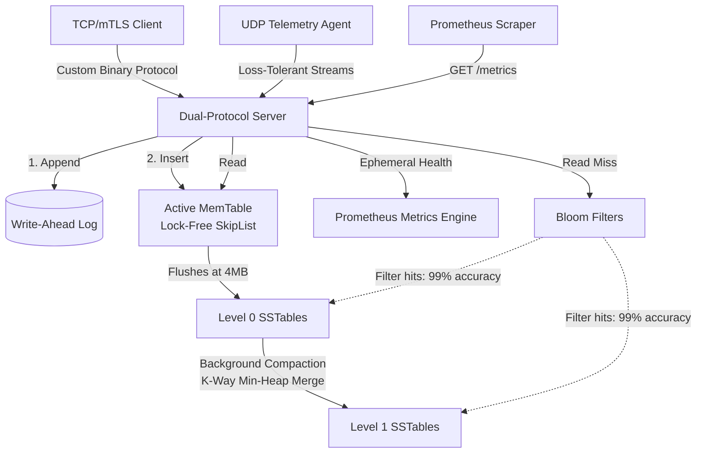

# Forest — High-Throughput LSM-Tree Storage Engine

[](https://github.com/Awesome06/Forest_DatabaseEngine/actions)
[](https://golang.org)
[](https://opensource.org/licenses/MIT)

Forest is a persistent, write-optimized distributed key-value store built entirely from scratch in Go. Designed for high write concurrency and sub-millisecond latencies, it leverages a Log-Structured Merge-Tree (LSM-Tree) architecture served over a raw, zero-allocation TCP binary socket. 


*CPU Flame Graph proving zero GC overhead and async WAL syncing. Notice the complete absence of `mallocgc` (Garbage Collection) blocks on the TCP read/write paths.*

## Contents
- [Quick Start \& Chaos Testing](#quick-start--chaos-testing)
- [Design Philosophy](#design-philosophy)
- [Performance: Zero-Allocation Hot Path](#performance-zero-allocation-hot-path)
- [System Architecture](#system-architecture)
- [Core Features](#core-features)
- [Production Observability & Grafana Dashboard](#production-observability--grafana-dashboard)
- [Dual-Protocol Architecture & mTLS Verification](#dual-protocol-architecture--mtls-verification)
- [Custom Binary Protocol](#custom-binary-protocol)
- [Project Layout](#project-layout)

## Quick Start & Chaos Testing
Forest is built to survive catastrophic failure. You can run the built-in Chaos Engineering suite on your local machine to watch the database recover from an abrupt `kill -9` process termination.

### 1. Prerequisites
- Go 1.22+
- Linux/macOS or Windows (PowerShell)

### 2. Run the Chaos Test
This script compiles the server, blasts it with concurrent writes, abruptly kills the process (`kill -9` / `Stop-Process -Force`), and validates that the WAL recovers 100% of the acknowledged data on reboot.

**On Linux / macOS:**
```bash
chmod +x ./scripts/chaos_test.sh
./scripts/chaos_test.sh
```

**On Windows (PowerShell):**
```powershell
powershell -ExecutionPolicy Bypass -File .\scripts\chaos_test.ps1
```

### 3. Run the Server Manually
```bash
# Build binary
go build -o bin/forest ./cmd/server

# Mode A: High-performance plaintext (TCP + UDP telemetry + Prometheus):
./bin/forest --port=9000 --udp-port=9001 --metrics-port=2112 --wal-dir=./data/wal --sst-dir=./data/sst

# Mode B: Mutual TLS (mTLS) secure node communication:
# 1. Generate development certificates instantly (ca.crt, server.crt/key, client.crt/key):
./bin/forest --gen-certs

# 2. Launch engine requiring strict two-way certificate authentication:
./bin/forest --port=9000 --udp-port=9001 --metrics-port=2112 --tls-cert=server.crt --tls-key=server.key --tls-ca=ca.crt
```

## Design Philosophy
Most modern applications rely on high-level databases without understanding the mechanical sympathy required to make them fast. I built Forest to bridge the gap between application logic and kernel-level hardware execution. The primary goals:
1. **Master Lock-Free Concurrency:** Eliminate mutex bottlenecks using atomic pointer swaps in a custom SkipList.
2. **Defeat Garbage Collection:** Prove that Go can handle extreme network throughput without stop-the-world GC pauses by engineering a zero-allocation hot path.
3. **Understand Disk I/O:** Implement Read-Copy-Update (RCU) file manifests and background compaction to manage disk fragmentation mathematically.
4. **Dual-Protocol Ingestion & Isolation:** Guarantee mission-critical storage writes over TCP while ingesting loss-tolerant telemetry streams concurrently over UDP using bounded buffer pools.
5. **Zero-Allocation Observability & mTLS:** Support encrypted cluster communication via mTLS without degrading throughput, and expose real-time Prometheus RED metrics with zero heap allocations on the hot path.

## Performance: Zero-Allocation Hot Path
High-level HTTP/REST APIs generate massive amounts of heap allocations, triggering Go's Garbage Collector. Forest circumvents this via custom TCP/UDP binary parsers that read headers directly from OS socket buffers.

**Parser Benchmarks (Zero-Copy):**
```text
goos: windows / linux
goarch: amd64
pkg: github.com/Forest_DatabaseEngine/internal/network
cpu: 13th Gen Intel(R) Core(TM) i5-13450HX
BenchmarkParseHeader-16             208481912         5.766 ns/op           0 B/op          0 allocs/op
BenchmarkParseTelemetryPacket-16    828279676         1.457 ns/op           0 B/op          0 allocs/op
BenchmarkHistogramObserve-16         28135791        42.370 ns/op           0 B/op          0 allocs/op
```
*Result: `5.76ns` TCP parsing latency and `1.45ns` UDP parsing latency with **zero heap allocations** per request, allowing the engine to sustain massive throughput without triggering GC pauses.*

## System Architecture



## Core Features
| Feature | Implementation Details |
| :--- | :--- |
| **Mutual TLS (mTLS)** | Full two-way certificate verification via Go standard library `crypto/tls` (TLS 1.3), isolating TLS handshakes from zero-allocation frame parsing. |
| **Dual-Protocol Ingestion** | Guaranteed delivery for database mutations over TCP, coupled with concurrent non-blocking UDP ingestion (`net.ListenUDP`) with bounded buffer pools and drop protection. |
| **Production Observability** | Pure Go stdlib Prometheus exposition (`/metrics`) tracking TCP throughput, parsing latency, UDP packet drops, MemTable swaps, and WAL fsync durations with zero hot-path allocations. |
| **Grafana Dashboard** | Pre-packaged local Grafana dashboard (`assets/grafana-dashboard.json`) visualizing RED metrics, latency histograms, and engine internals in real-time. |
| **Lock-Free MemTable** | Uses a concurrent SkipList and Go's `sync/atomic` primitives to eliminate thread contention under heavy write load. |
| **Crash-Safe Durability** | Implements Write-Ahead Logging (WAL) with double-buffering and CRC32 checksums. Ensures zero data loss up to the last network ACK. |
| **Disk-Optimized SSTables** | Append-only Sorted String Tables featuring integrated custom Bloom Filters (bit arrays) to mathematically eliminate disk reads for non-existent keys. |
| **RCU Compaction** | A dedicated background worker pool merges Level-0 files into sorted Level-1 files asynchronously using RCU reference counting. |

## Production Observability & Grafana Dashboard

Forest features an in-house, zero-allocation Prometheus exporter implemented entirely with the Go standard library (no third-party dependencies). It exposes RED (Rate, Errors, Duration) metrics and internal storage engine diagnostics on HTTP `GET /metrics`.

### 1. Scrape Endpoint
When the server is running with `--metrics-port=2112`, inspect live telemetry via `curl`:
```bash
curl http://127.0.0.1:2112/metrics
```

**Sample Prometheus Text Output:**
```text
# HELP forest_tcp_requests_total Total TCP database requests processed
# TYPE forest_tcp_requests_total counter
forest_tcp_requests_total{op="put",status="ok"} 10000
forest_tcp_requests_total{op="get",status="ok"} 2500

# HELP forest_tcp_request_latency_seconds Latency of TCP request handling
# TYPE forest_tcp_request_latency_seconds histogram
forest_tcp_request_latency_seconds_bucket{le="0.0001"} 9980
forest_tcp_request_latency_seconds_bucket{le="0.0005"} 10000
forest_tcp_request_latency_seconds_count 10000

# HELP forest_wal_sync_duration_seconds Latency of Write-Ahead Log sync operations
# TYPE forest_wal_sync_duration_seconds histogram
forest_wal_sync_duration_seconds_bucket{le="0.001"} 142
forest_wal_sync_duration_seconds_count 142

# HELP forest_memtable_swaps_total Total MemTable freeze and swap events triggered
# TYPE forest_memtable_swaps_total counter
forest_memtable_swaps_total 3

# HELP forest_udp_packets_total Total UDP telemetry packets received
# TYPE forest_udp_packets_total counter
forest_udp_packets_total 42

# HELP forest_udp_drops_total Total UDP telemetry packets dropped due to corruption or queue saturation
# TYPE forest_udp_drops_total counter
forest_udp_drops_total 0

# HELP go_goroutines Number of goroutines that currently exist.
# TYPE go_goroutines gauge
go_goroutines 7
```

### 2. Import Pre-Configured Grafana Dashboard
A production-ready Grafana dashboard definition is bundled in `assets/grafana-dashboard.json`.
To load it into your Grafana instance:
1. Open Grafana (`http://localhost:3000`).
2. Navigate to **Dashboards** → **New** → **Import**.
3. Upload [`assets/grafana-dashboard.json`](assets/grafana-dashboard.json) or paste its raw JSON.
4. Select your Prometheus data source pointed at `http://localhost:2112`.
5. Gain instant visibility into ops/sec throughput, p99 request latencies, WAL sync durations, MemTable freeze frequencies, and UDP buffer drops.

---

## Dual-Protocol Architecture & mTLS Verification

### 1. Loss-Tolerant UDP Telemetry
Forest separates database mutations from ephemeral health telemetry. You can blast UDP heartbeats or telemetry datagrams to port 9001:
```bash
# Send a UDP Heartbeat packet (0xA1 magic byte + 0x06 OpHeartbeat + 0x0000 length)
echo -ne '\xa1\x06\x00\x00' | nc -u -w1 127.0.0.1 9001
```

### 2. Mutual TLS (mTLS) Cluster Communication
In production, cluster nodes authenticate each other with TLS 1.3 mutual certificates. Connect using the Go client helper:
```go
clientTLS, err := network.LoadClientTLSConfig("client.crt", "client.key", "ca.crt", "localhost")
if err != nil {
    log.Fatal(err)
}

conn, err := tls.Dial("tcp", "127.0.0.1:9000", clientTLS)
if err != nil {
    log.Fatal(err)
}
defer conn.Close()
```

## Custom Binary Protocol
To maximize throughput, Forest uses a strict 8-byte TCP header and a 4-byte UDP telemetry header, eliminating the parsing overhead of JSON or HTTP.

### TCP Request Header (8 Bytes)
| Field | Size | Description |
| :--- | :--- | :--- |
| **Magic Byte** | 1 Byte | Validation byte (`0xA1`) to reject malformed packets immediately. |
| **OpCode** | 1 Byte | Operation type: `0x01` (Echo), `0x02` (Put), `0x03` (Get), `0x04` (Delete). |
| **Key Length** | 2 Bytes | Unsigned 16-bit integer defining key size. |
| **Value Length**| 4 Bytes | Unsigned 32-bit integer defining payload size. |
| **Payload** | Variable| Raw bytes containing `Key + Value`. |

### UDP Telemetry Header (4 Bytes)
| Field | Size | Description |
| :--- | :--- | :--- |
| **Magic Byte** | 1 Byte | Validation byte (`0xA1`). |
| **OpCode** | 1 Byte | `0x05` (Telemetry) or `0x06` (Heartbeat). |
| **Payload Length**| 2 Bytes | Unsigned 16-bit integer defining telemetry payload size. |
| **Payload** | Variable| Loss-tolerant health/metrics payload. |

## Project Layout
```text
.
├── cmd/
│   └── server/          # Main application entrypoint with flags for TCP, UDP, mTLS, and Prometheus
├── internal/
│   ├── engine/          # LSM-Tree engine core (MemTable, SSTables, WAL, Bloom Filter, Compactor)
│   ├── network/         # Dual-protocol server, mTLS TLS helpers, zero-allocation TCP/UDP parsers
│   └── metrics/         # Zero-allocation stdlib Prometheus metrics registry and /metrics handler
├── assets/              # Architecture diagrams, flamegraphs, and Grafana dashboard JSON
├── scripts/             # Chaos testing and benchmarking bash scripts
├── data/                # Local storage for WAL and SST files (gitignored)
└── README.md
```

---

## Contact
**Mrigank Bhatnagar**  
* [LinkedIn](https://linkedin.com/in/mrigank-bhatnagar)
* [GitHub](https://github.com/Awesome06)
