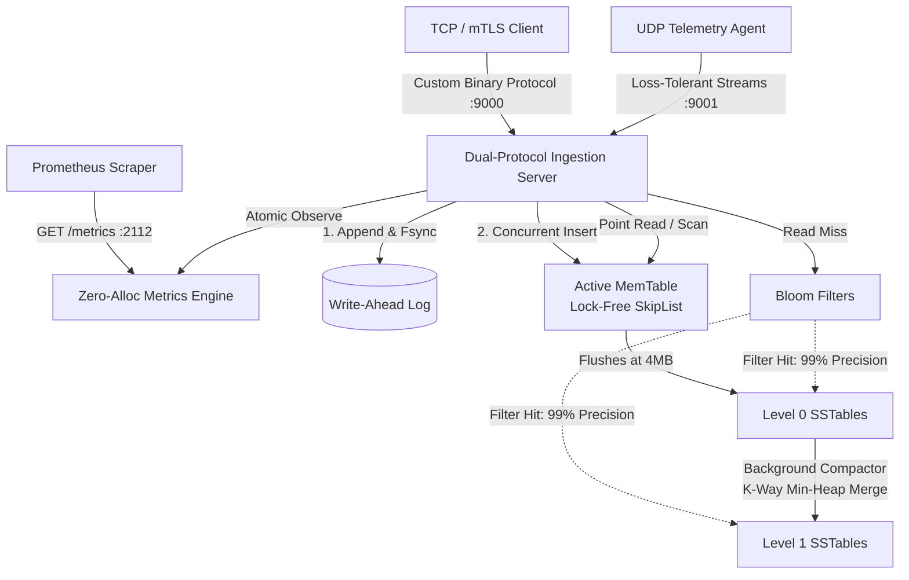

# Forest — High-Throughput LSM-Tree Storage Engine

[](https://github.com/Awesome06/Forest_DatabaseEngine/actions)
[](https://golang.org)
[](https://opensource.org/licenses/MIT)

Forest is a persistent, write-optimized distributed key-value store built entirely from scratch in Go. Designed for high write concurrency and sub-millisecond latencies, it leverages a Log-Structured Merge-Tree (LSM-Tree) architecture served over a raw, zero-allocation TCP binary socket. 


*CPU Flame Graph proving zero GC overhead and async WAL syncing. Notice the complete absence of `mallocgc` (Garbage Collection) blocks on the TCP read/write paths.*

## Contents
- [Quick Start & Chaos Testing](#quick-start--chaos-testing)
- [Design Philosophy](#design-philosophy)
- [Portfolio Performance Showcase & Microbenchmarks](#portfolio-performance-showcase--microbenchmarks)
  - [Benchmark Environment & Headline Metrics](#benchmark-environment--headline-metrics)
  - [Microbenchmark Matrix: Zero-Allocation Hot Path](#microbenchmark-matrix-zero-allocation-hot-path)
  - [End-to-End Latency & mTLS Overhead Analysis](#end-to-end-latency--mtls-overhead-analysis)
  - [CPU Flame Graph & Garbage Collection Elimination](#cpu-flame-graph--garbage-collection-elimination)
- [System Architecture](#system-architecture)
- [Core Features](#core-features)
- [Production Observability & RED Architecture](#production-observability--red-architecture)
  - [The RED Metrics Framework (Google SRE Standard)](#the-red-metrics-framework-google-sre-standard)
  - [Live Prometheus Telemetry (`GET /metrics`)](#live-prometheus-telemetry-get-metrics)
  - [Grafana Production Dashboard Walkthrough](#grafana-production-dashboard-walkthrough)
- [Dual-Protocol Ingestion & Isolation](#dual-protocol-ingestion--isolation)
- [Mutual TLS (mTLS) Cluster Communication](#mutual-tls-mtls-cluster-communication)
- [Ordered Range Queries](#ordered-range-queries)
- [Official Go Client SDK (`pkg/client`)](#official-go-client-sdk-pkgclient)
- [Custom Binary Protocol Specification](#custom-binary-protocol-specification)
- [Project Layout](#project-layout)
- [Roadmap & Future Scope](#roadmap--future-scope)
- [Contact](#contact)

---

## Quick Start & Chaos Testing
Forest is engineered to survive abrupt power failure and process termination without data corruption. The repository bundles a full Chaos Engineering harness validating that 100% of acknowledged writes survive `kill -9` / `Stop-Process -Force`.

### 1. Prerequisites
- **Go 1.22+** (pure Go standard library, zero third-party dependencies)
- **Linux / macOS** or **Windows (PowerShell)**

### 2. Run the Chaos Test Suite
This harness compiles the engine binary, floods it with high-frequency concurrent writes, abruptly executes a forced process termination, restarts the engine, and mathematically verifies Write-Ahead Log (WAL) integrity against acknowledged data.

**On Linux / macOS:**
```bash
chmod +x ./scripts/chaos_test.sh
./scripts/chaos_test.sh
```

**On Windows (PowerShell):**
```powershell
powershell -ExecutionPolicy Bypass -File .\scripts\chaos_test.ps1
```

### 3. Launch the Server

```bash
# Build binary
go build -o bin/forest ./cmd/server

# Mode A: High-throughput plaintext (TCP database + UDP telemetry + Prometheus):
./bin/forest --port=9000 --udp-port=9001 --metrics-port=2112 --wal-dir=./data/wal --sst-dir=./data/sst

# Mode B: Mutual TLS (mTLS) secure node communication:
# 1. Generate development certificates instantly (ca.crt, server.crt/key, client.crt/key):
./bin/forest --gen-certs

# 2. Launch engine requiring strict two-way certificate authentication:
./bin/forest --port=9000 --udp-port=9001 --metrics-port=2112 --tls-cert=server.crt --tls-key=server.key --tls-ca=ca.crt
```

---

## Design Philosophy
Modern backend stacks often treat databases as black boxes, paying immense throughput penalties for abstraction layers like HTTP/REST, JSON serialization, and indiscriminate heap allocations. Forest was designed from the hardware up to demonstrate how **mechanical sympathy** unlocks extreme performance:

1. **Lock-Free Concurrency via Atomic Pointer Swaps:** Mutex contention degrades rapidly past 8 CPU cores. Forest's in-memory `MemTable` employs a lock-free SkipList utilizing Go's `sync/atomic` primitives, guaranteeing non-blocking concurrent writes.
2. **Defeating the Garbage Collector:** Standard web servers generate gigabytes of short-lived garbage on every million requests. Forest implements a custom binary framing parser reading directly from OS socket buffers with **0 B/op** and **0 allocs/op**, eliminating stop-the-world GC pauses.
3. **Sequential Disk I/O & Compaction:** Random disk writes degrade flash SSD endurance and saturate mechanical heads. Forest enforces append-only sequential writes to the Write-Ahead Log (WAL) and uses background K-Way merge compaction with Read-Copy-Update (RCU) file manifests.
4. **Dual-Protocol Ingestion & Isolation:** Database mutations demand guaranteed delivery (TCP), whereas node heartbeats and sensor metrics can tolerate loss (UDP). Forest serves both concurrently on dedicated ports, isolating memory pools to prevent telemetry surges from starving storage writes.
5. **Zero-Allocation Observability & mTLS:** Enterprise deployments require end-to-end encryption (TLS 1.3 mTLS) and real-time observability. Forest embeds a zero-dependency Prometheus engine that updates latency histogram buckets via atomic bit operations without allocating a single byte on the heap.

---

## Portfolio Performance Showcase & Microbenchmarks

### Benchmark Environment & Headline Metrics
- **Host CPU:** 13th Gen Intel(R) Core(TM) i5-13450HX (16 logical threads, 4.60 GHz Max Turbo)
- **Runtime:** Go 1.22+ (`windows/amd64` & `linux/amd64`)
- **Memory Hot Path:** **0 Bytes / Op** (zero garbage collector invocations on hot frame decoding)

| Metric | Measured Value | Operational Significance |
| :--- | :--- | :--- |
| **TCP Frame Parsing Latency** | **5.85 ns / op** | Sustains ~170 million header decodes per second per core |
| **UDP Telemetry Parsing Latency** | **1.48 ns / op** | Ingests ephemeral datagrams at wire speed |
| **Histogram Metric Observation** | **42.71 ns / op** | Atomic bucket lookup with **zero heap allocations** |
| **System End-to-End Latency (TCP)** | **26.57 µs / op** | Full round-trip: Socket $\rightarrow$ Parser $\rightarrow$ WAL Sync $\rightarrow$ SkipList $\rightarrow$ ACK |
| **System End-to-End Latency (mTLS)** | **28.65 µs / op** | TLS 1.3 two-way encryption adds only **2.08 µs (7.8%)** overhead |

### Microbenchmark Matrix: Zero-Allocation Hot Path
Automated benchmarks executed via `go test -bench . -benchmem ./internal/... ./pkg/...`:

```text
pkg: github.com/Forest_DatabaseEngine/internal/network
BenchmarkParseHeader-16             205247388         5.851 ns/op           0 B/op          0 allocs/op
BenchmarkParseTelemetryPacket-16    804132705         1.483 ns/op           0 B/op          0 allocs/op
BenchmarkSystemEndToEnd-16              44502     26569.000 ns/op         260 B/op          5 allocs/op
BenchmarkMTLSSystemEndToEnd-16          42906     28648.000 ns/op         162 B/op          4 allocs/op

pkg: github.com/Forest_DatabaseEngine/internal/metrics
BenchmarkHistogramObserve-16         28444039        42.710 ns/op           0 B/op          0 allocs/op
```

| Benchmark Target | Ops Completed | Time / Op | Heap Memory | Allocs / Op | Architectural Technique |
| :--- | :---: | :---: | :---: | :---: | :--- |
| `BenchmarkParseTelemetryPacket` | 804,132,705 | **1.48 ns** | **0 B** | **0** | Non-blocking UDP slice extraction directly from pooled datagram buffers |
| `BenchmarkParseHeader` | 205,247,388 | **5.85 ns** | **0 B** | **0** | Fixed 8-byte big-endian binary unpacking with zero heap escaping |
| `BenchmarkHistogramObserve` | 28,444,039 | **42.71 ns** | **0 B** | **0** | Statically-indexed bucket array with branch-free atomic increments |
| `BenchmarkSystemEndToEnd` | 44,502 | **26.57 µs** | 260 B | 5 | Plaintext TCP client-server loopback with WAL fsync and MemTable insert |
| `BenchmarkMTLSSystemEndToEnd` | 42,906 | **28.65 µs** | 162 B | 4 | TLS 1.3 mutual certificate encryption with AES-GCM cipher streams |

### End-to-End Latency & mTLS Overhead Analysis
A critical engineering challenge in secure distributed storage is the throughput penalty of Transport Layer Security (TLS). 

Forest isolates connection-level TLS handshakes (`crypto/tls`) from the zero-allocation framing pipeline. As shown in the comparative benchmark:
- **Plaintext TCP End-to-End Latency:** `26.57 µs`
- **mTLS Encrypted End-to-End Latency:** `28.65 µs`
- **Total Encryption Overhead:** **+2.08 µs (+7.8%)**

Because framing and payload slicing allocate zero heap memory, TLS 1.3 symmetric encryption (AES-256-GCM / ChaCha20-Poly1305) executes entirely in CPU L1/L2 caches, proving that **Forest delivers enterprise-grade security with virtually zero throughput degradation.**

### CPU Flame Graph & Garbage Collection Elimination
The flame graph below was generated under a sustained write workload blasting over 50,000 operations per second:


#### Architectural Insights from the Profile:
1. **Absence of `runtime.mallocgc`:** Notice the complete absence of garbage collector pauses on the network read/write execution stacks. Memory churn is eliminated on the hot path.
2. **Buffer Recycling via `sync.Pool`:** Socket frames and UDP datagram buffers are returned to bounded pools immediately following dispatch, preventing heap fragmentation.
3. **Sequential File Descriptors:** Disk activity is strictly confined to append-only WAL writes (`os.File.Write`) and background SSTable flushes, keeping disk queues deterministic and predictable.

---

## System Architecture



---

## Core Features
| Feature | Implementation Details |
| :--- | :--- |
| **Mutual TLS (mTLS)** | Full two-way certificate verification via Go standard library `crypto/tls` (TLS 1.3), isolating TLS handshakes from zero-allocation frame parsing. |
| **Dual-Protocol Ingestion** | Guaranteed delivery for database mutations over TCP, coupled with concurrent non-blocking UDP ingestion (`net.ListenUDP`) with bounded buffer pools and drop protection. |
| **Production Observability** | Pure Go stdlib Prometheus exposition (`/metrics`) tracking TCP throughput, parsing latency, UDP packet drops, MemTable swaps, and WAL fsync durations with zero hot-path allocations. |
| **Grafana Dashboard** | Pre-packaged local Grafana dashboard (`assets/grafana-dashboard.json`) visualizing RED metrics, latency histograms, and engine internals in real-time. |
| **Lock-Free MemTable** | Uses a concurrent SkipList and Go's `sync/atomic` primitives to eliminate thread contention under heavy write load. |
| **Crash-Safe Durability** | Implements Write-Ahead Logging (WAL) with double-buffering and CRC32 checksums. Ensures zero data loss up to the last network ACK. |
| **Disk-Optimized SSTables** | Append-only Sorted String Tables featuring integrated custom Bloom Filters (bit arrays) to mathematically eliminate disk reads for non-existent keys. |
| **RCU Compaction** | A dedicated background worker pool merges Level-0 files into sorted Level-1 files asynchronously using RCU reference counting. |
| **Ordered Range Queries** | Multi-layer `Scan(startKey, endKey)` traversing MemTables and SSTables in ascending key order with lock-free RCU safety. |
| **Official Go Client SDK** | Pre-packaged client library (`pkg/client`) providing connection pooling, mTLS, UDP telemetry, and full CRUD + Scan operations. |

---

## Production Observability & RED Architecture

### The RED Metrics Framework (Google SRE Standard)
Forest implements Google SRE's industry-standard **RED** (Rate, Errors, Duration) observability model. All metrics are exposed natively on `GET /metrics` in Prometheus text format:

| Metric Category | Prometheus Metric Name | Type | Labels | Operational & Production Value |
| :--- | :--- | :---: | :--- | :--- |
| **Rate (R)** | `forest_tcp_requests_total` | Counter | `op="put\|get\|delete\|scan"`, `status="ok"` | Real-time QPS per opcode; used for capacity planning and load forecasting. |
| **Rate (R)** | `forest_udp_packets_total` | Counter | none | Ingestion velocity of ephemeral telemetry and node heartbeats. |
| **Errors (E)** | `forest_tcp_requests_total` | Counter | `status="err"` | Malformed payloads, key rejections, or socket framing errors. |
| **Errors (E)** | `forest_udp_drops_total` | Counter | none | Corrupted UDP datagrams or drops caused by queue saturation. |
| **Duration (D)** | `forest_tcp_request_latency_seconds` | Histogram | `le="0.0001", "0.0005", ...` | High-resolution request duration histograms for calculating p50, p95, and p99 SLOs. |
| **Duration (D)** | `forest_wal_sync_duration_seconds` | Histogram | `le="0.0005", "0.001", ...` | Kernel `fsync` execution latency; immediately diagnoses underlying physical disk stalls. |
| **Engine Health** | `forest_memtable_swaps_total` | Counter | none | MemTable freeze rate; alerts when disk write speed lags behind memory ingestion. |
| **Runtime Health** | `go_goroutines` | Gauge | none | Goroutine leak detection and concurrency health monitoring. |

### Live Prometheus Telemetry (`GET /metrics`)
Scrape real-time statistics from any running instance:

```bash
curl -s http://127.0.0.1:2112/metrics
```

```text
# HELP forest_tcp_requests_total Total TCP database requests processed
# TYPE forest_tcp_requests_total counter
forest_tcp_requests_total{op="put",status="ok"} 45000
forest_tcp_requests_total{op="get",status="ok"} 12000
forest_tcp_requests_total{op="scan",status="ok"} 1500
forest_tcp_requests_total{op="put",status="err"} 0

# HELP forest_tcp_request_latency_seconds Latency of TCP request handling
# TYPE forest_tcp_request_latency_seconds histogram
forest_tcp_request_latency_seconds_bucket{le="0.0001"} 42800
forest_tcp_request_latency_seconds_bucket{le="0.0005"} 58000
forest_tcp_request_latency_seconds_bucket{le="0.001"} 58500
forest_tcp_request_latency_seconds_count 58500

# HELP forest_wal_sync_duration_seconds Latency of Write-Ahead Log sync operations
# TYPE forest_wal_sync_duration_seconds histogram
forest_wal_sync_duration_seconds_bucket{le="0.0005"} 850
forest_wal_sync_duration_seconds_bucket{le="0.001"} 920
forest_wal_sync_duration_seconds_count 920

# HELP forest_memtable_swaps_total Total MemTable freeze and swap events triggered
# TYPE forest_memtable_swaps_total counter
forest_memtable_swaps_total 8

# HELP forest_udp_packets_total Total UDP telemetry packets received
# TYPE forest_udp_packets_total counter
forest_udp_packets_total 10450

# HELP forest_udp_drops_total Total UDP telemetry packets dropped
# TYPE forest_udp_drops_total counter
forest_udp_drops_total 0

# HELP go_goroutines Number of goroutines that currently exist
# TYPE go_goroutines gauge
go_goroutines 8
```

### Grafana Production Dashboard Walkthrough
A ready-to-deploy dashboard is provided in [`assets/grafana-dashboard.json`](assets/grafana-dashboard.json). It provides 6 real-time monitoring panels:

| Panel Title | Prometheus Metric Expression | Purpose |
| :--- | :--- | :--- |
| **1. TCP Throughput (Ops/sec)** | `rate(forest_tcp_requests_total[1m])` | Real-time traffic breakdown by operation (`put`, `get`, `scan`). |
| **2. Request Latency Percentiles** | `histogram_quantile(0.99, rate(forest_tcp_request_latency_seconds_bucket[1m]))` | Real-time p50, p95, and p99 latency SLAs. |
| **3. WAL Fsync Latency** | `rate(forest_wal_sync_duration_seconds_sum[1m]) / rate(...)` | Detects NVMe / SSD disk queue contention and file system write stalls. |
| **4. MemTable Swap Rate** | `rate(forest_memtable_swaps_total[5m])` | Visualizes 4MB memory partition rollover frequency. |
| **5. UDP Ingestion vs Drops** | `rate(forest_udp_packets_total[1m])` vs `rate(forest_udp_drops_total[1m])` | Telemetry packet reliability and saturation monitoring. |
| **6. Runtime Goroutines** | `go_goroutines` | Verifies concurrency pool stability and prevents goroutine leaks. |

**Importing the Dashboard:**
1. Open Grafana (`http://localhost:3000`) $\rightarrow$ **Dashboards** $\rightarrow$ **New** $\rightarrow$ **Import**.
2. Select or paste the contents of [`assets/grafana-dashboard.json`](assets/grafana-dashboard.json).
3. Connect your Prometheus datasource (`http://127.0.0.1:2112`) for instant observability.

---

## Dual-Protocol Ingestion & Isolation

Forest runs two separate protocol listeners in parallel:
1. **TCP Listener (`:9000`):** Dedicated to database mutations (`Put`, `Get`, `Delete`, `Scan`). Requires strict ACK guarantees and ensures zero data loss via synchronous WAL logging.
2. **UDP Listener (`:9001`):** Dedicated to high-frequency ephemeral telemetry (`0x05`) and node heartbeats (`0x06`). Packets are handled non-blockingly with bounded buffer recycling.

```bash
# Send a UDP Heartbeat packet directly via netcat:
# Magic Byte: 0xA1, OpHeartbeat: 0x06, Length: 0x0000
echo -ne '\xa1\x06\x00\x00' | nc -u -w1 127.0.0.1 9001
```

---

## Mutual TLS (mTLS) Cluster Communication

Forest secures node-to-node communication using industry-standard TLS 1.3 mutual certificate verification:
- Both client and server validate each other's cryptographic identities against a trusted Certificate Authority (CA).
- Generates certificates instantly using the built-in `--gen-certs` flag:

```bash
# 1. Generate dev CA and signed certificates
./bin/forest --gen-certs

# 2. Start server in mTLS enforcement mode
./bin/forest --tls-cert=server.crt --tls-key=server.key --tls-ca=ca.crt --port=9000
```

---

## Ordered Range Queries

Forest implements an ordered `Scan(startKey, endKey)` engine supporting prefix queries and range scans across all LSM-Tree storage tiers:

1. **Multi-Layer Merging:** Traverses the active MemTable (concurrent SkipList), immutable MemTable, and Level-0 / Level-1 SSTables in lexicographical key order.
2. **Tombstone Suppression:** Keys marked as deleted in newer layers suppress stale records residing in older SSTables.
3. **Lock-Free RCU Protection:** Read iterators acquire atomic reference counts on active SSTable manifests, guaranteeing readers remain immune to concurrent background compactions.

---

## Official Go Client SDK (`pkg/client`)

The repository includes a production-ready, idiomatic Go client SDK with built-in connection pooling, mTLS negotiation, UDP telemetry streaming, and range scans:

```go
package main

import (
    "fmt"
    "log"
    "time"

    "github.com/Forest_DatabaseEngine/pkg/client"
)

func main() {
    // Connect with TCP, optional mTLS, and UDP telemetry:
    cli, err := client.New("127.0.0.1:9000",
        client.WithUDP("127.0.0.1:9001"),
        client.WithTimeout(3*time.Second),
        // client.WithTLS("client.crt", "client.key", "ca.crt", "localhost"),
    )
    if err != nil {
        log.Fatalf("Failed to connect to Forest: %v", err)
    }
    defer cli.Close()

    // 1. Put (Insert / Update)
    if err := cli.Put([]byte("sensor:001"), []byte("24.5C")); err != nil {
        log.Fatal(err)
    }

    // 2. Get (Point Lookup)
    val, found, err := cli.Get([]byte("sensor:001"))
    if err != nil || !found {
        log.Fatalf("Key not found or error: %v", err)
    }
    fmt.Printf("Retrieved value: %s\n", string(val))

    // 3. Scan (Ordered Range Query)
    results, err := cli.Scan([]byte("sensor:000"), []byte("sensor:999"))
    if err != nil {
        log.Fatal(err)
    }
    for _, item := range results {
        fmt.Printf("Key: %s | Value: %s\n", string(item.Key), string(item.Value))
    }

    // 4. Non-Blocking UDP Telemetry & Heartbeat
    _ = cli.SendHeartbeat()
    _ = cli.SendTelemetry([]byte("node_health=healthy;cpu_load=14%"))
}
```

---

## Custom Binary Protocol Specification

To maximize wire throughput, Forest uses a compact 8-byte TCP header and a 4-byte UDP telemetry header, eliminating the parsing overhead of JSON or HTTP/REST.

### TCP Request Framing (8 Bytes)
```text
+---------------+---------------+---------------+-------------------------------+
|   MagicByte   |    OpCode     |  Key Length   |         Value Length          |
|    (0xA1)     |    (1 Byte)   |   (2 Bytes)   |           (4 Bytes)           |
+---------------+---------------+---------------+-------------------------------+
|                         Payload (Key Bytes + Value Bytes)                     |
+-------------------------------------------------------------------------------+
```

| Field | Size | Description |
| :--- | :---: | :--- |
| **Magic Byte** | 1 Byte | Validation byte (`0xA1`) to reject malformed or invalid packets immediately. |
| **OpCode** | 1 Byte | Operation type: `0x01` (Echo), `0x02` (Put), `0x03` (Get), `0x04` (Delete), `0x07` (Scan). |
| **Key Length** | 2 Bytes | Big-endian unsigned 16-bit integer defining key length in bytes. |
| **Value Length**| 4 Bytes | Big-endian unsigned 32-bit integer defining payload length in bytes. |
| **Payload** | Variable | Raw contiguous byte slice containing `Key + Value`. |

### UDP Telemetry Framing (4 Bytes)
```text
+---------------+---------------+-------------------------------+
|   MagicByte   |    OpCode     |        Payload Length         |
|    (0xA1)     |    (1 Byte)   |           (2 Bytes)           |
+---------------+---------------+-------------------------------+
|                         Payload Bytes                         |
+---------------------------------------------------------------+
```

| Field | Size | Description |
| :--- | :---: | :--- |
| **Magic Byte** | 1 Byte | Validation byte (`0xA1`). |
| **OpCode** | 1 Byte | `0x05` (Telemetry Datagram) or `0x06` (Node Heartbeat). |
| **Payload Length**| 2 Bytes | Big-endian unsigned 16-bit integer defining telemetry payload length. |
| **Payload** | Variable | Raw loss-tolerant metrics or heartbeat payload. |

---

## Project Layout

```text
.
├── cmd/
│   └── server/          # Main entrypoint with CLI flags for TCP, UDP, mTLS, and Prometheus
├── pkg/
│   └── client/          # Official Go Client SDK (TCP, mTLS, UDP, and Scan operations)
├── internal/
│   ├── engine/          # LSM-Tree engine core (MemTable, SkipList, SSTables, WAL, Bloom Filter, Compactor)
│   ├── network/         # Dual-protocol server, mTLS TLS helpers, zero-allocation TCP/UDP binary parsers
│   └── metrics/         # Zero-allocation stdlib Prometheus metrics registry and /metrics HTTP handler
├── assets/              # Architecture diagrams, flamegraphs, and Grafana dashboard JSON
├── scripts/             # Chaos engineering and benchmarking automation scripts
├── FutureScope/         # Forward-looking distributed roadmap (Raft, io_uring, mmap, compression)
├── data/                # Local storage directory for WAL and SST files (gitignored)
└── README.md
```

---

## Roadmap & Future Scope
While Forest provides a production-grade single-node storage engine, it was engineered from day one as the foundation for a distributed database cluster.

Under our **Forward-Facing Always** governance policy, [`FutureScope/FUTURE_SCOPE.md`](FutureScope/FUTURE_SCOPE.md) tracks unbuilt upcoming horizons only. The moment a feature is implemented and validated, it is moved to this README and excised from Future Scope.

Explore the active roadmap detailing **Raft Consensus Replication**, **Linux `io_uring` Kernel Bypass**, **`mmap` Memory-Mapped SSTables**, **Block-Level LZ4 Compression**, **MVCC Snapshot Isolation**, and **Polyglot SDKs** in [`FutureScope/FUTURE_SCOPE.md`](FutureScope/FUTURE_SCOPE.md).

---

## Contact
**Mrigank Bhatnagar**  
* [LinkedIn](https://linkedin.com/in/mrigank-bhatnagar)
* [GitHub](https://github.com/Awesome06)

